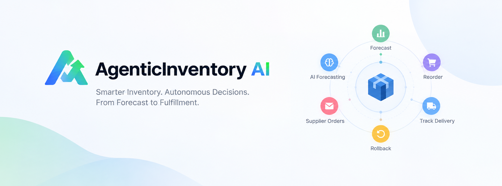
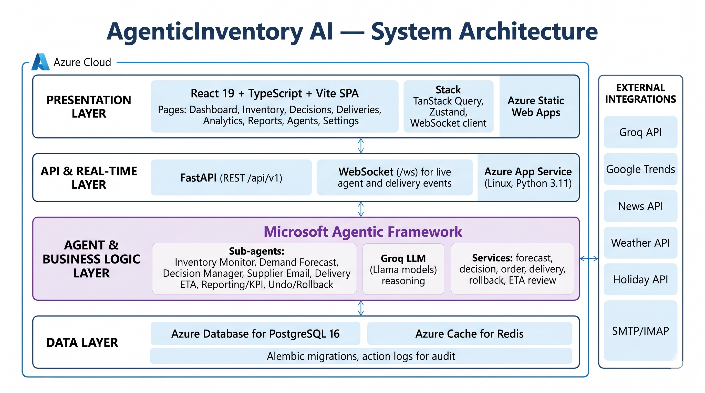

# AgenticInventory AI

AgenticInventory AI is an autonomous inventory intelligence platform that monitors stock, forecasts demand with LLM-driven reasoning, decides whether to reorder, sends supplier purchase orders, tracks delivery updates, and supports rollback with auditability.



## Project Demo

<p align="center">
  <a href="https://youtu.be/6DrhlbHWwZk">
    
  </a>
</p>

<p align="center">
  <b>▶️ Watch the Full Project Demo on YouTube</b>
</p>
## Why This Project

Traditional procurement workflows are reactive and manual. This project automates the full loop:

- detect low stock early
- forecast likely demand with external intelligence signals
- make explainable reorder decisions
- execute supplier communication
- track delivery progress including supplier ETA replies
- allow safe undo for autonomous actions
## System Architecure:


## Tech Stack
.png)


## Core Capabilities

- Autonomous multi-agent monitoring loop running on the backend
- Manual pipeline trigger for demos and controlled runs
- Live WebSocket-driven pipeline visualization in the UI
- Inventory CRUD with stock health and reorder signals
- AI-assisted demand forecasting and confidence scoring
- Decision manager with configurable confidence thresholds
- Supplier order email generation and sending
- Delivery tracking with timeline and ETA revision handling
- Supplier ETA ingestion from inbox replies (IMAP + extraction + review queue)
- Rollback/undo flow with action logs and compensating actions
- Analytics and KPI reporting endpoints and report delivery settings

## System Architecture

```text
Frontend (React + TypeScript + Vite)
  - Azure Static Web Apps (production)
  - Pages: Dashboard, Inventory, Decisions, Deliveries, Analytics, Reports, Agents, Settings
            |
            | REST (/api/v1/*) + WS (/ws)
            v
Backend (FastAPI + SQLAlchemy Async)
  - Azure App Service — Linux, Python 3.11 (production)
  - Agents, services, autonomous monitoring loop
            |
            v
Data (Azure managed)
  - Azure Database for PostgreSQL 16
  - Azure Cache for Redis (optional)
```

## Tech Stack

### Frontend

- React 19, TypeScript, Vite, Tailwind CSS 4, Framer Motion, TanStack Query, Zustand, Recharts

### Backend

- Python 3.11+, FastAPI, SQLAlchemy 2 (async), Alembic, Pydantic, JWT, Jinja2

### AI and Intelligence

- Microsoft AutoGen, Groq (Llama models), Google Trends, News, Weather, Holiday APIs

### Cloud (production target)

- Azure App Service, Azure Static Web Apps, Azure Database for PostgreSQL, Azure Cache for Redis
- Bicep templates and Azure Pipelines in `infrastructure/azure/`

## Repository Structure

```text
.
├── backend/                    # FastAPI application
├── frontend/                   # React SPA
├── infrastructure/
│   └── azure/                  # Bicep IaC, deployment guide, CI pipeline
├── specs/                      # Feature specifications
├── .env.example                # Environment template (copy to backend/.env)
└── Makefile                    # Local dev commands (no Docker)
```

## Local Development (no Docker)

### Prerequisites

- Python 3.11+
- Node.js 18+ (20 recommended)

### Backend

```powershell
cd backend
python -m venv .venv
.\.venv\Scripts\Activate.ps1
pip install -r requirements.txt
copy ..\.env.example .env
# Edit .env — GROQ_API_KEY, JWT_SECRET_KEY; SQLite works out of the box
alembic upgrade head
uvicorn app.main:app --reload
```

### Frontend

```powershell
cd frontend
npm install
npm run dev
```
=\  
### URLs

- Frontend: http://localhost:5173
- API: http://localhost:8000/api/v1
- Swagger: http://localhost:8000/docs

Or run both: `make dev` (from repo root).

## Azure Deployment (ready, not executed by default)

Infrastructure and deployment steps are documented in **[infrastructure/azure/README.md](infrastructure/azure/README.md)**.

Quick overview:

1. **Provision** — `az deployment sub create` with `infrastructure/azure/bicep/main.bicep`
2. **Configure secrets** — JWT, Groq, CORS, SMTP on App Service
3. **Deploy backend** — zip deploy `backend/` to App Service
4. **Deploy frontend** — build with `VITE_*` URLs, deploy `dist/` to Static Web App
5. **Migrate** — `alembic upgrade head` on the App Service instance

CI/CD template: `infrastructure/azure/pipelines/azure-pipelines.yml` (build enabled; deploy gated by `deployEnabled: false`).

## Environment Configuration

Copy `.env.example` to `backend/.env`. Key settings:

| Variable | Purpose |
|----------|---------|
| `DATABASE_URL` | SQLite (local) or PostgreSQL (Azure) |
| `REDIS_URL` | Optional locally; `rediss://` on Azure |
| `GROQ_API_KEY` | Required for AI agents |
| `JWT_SECRET_KEY` | Auth signing (rotate in production) |
| `CORS_ORIGINS` | Include Static Web App URL in Azure |
| `FRONTEND_BASE_URL` | Email deep links |

Frontend production build: see `frontend/.env.production.example`.

## Running Tests

```powershell
cd backend && python -m pytest -q
cd frontend && npm run test
```

## API and Real-Time

- REST: `/api/v1`
- WebSocket: `/ws`
- Docs: `/docs` (when backend is running)

## License

Private/internal project unless explicitly relicensed by the repository owner.
